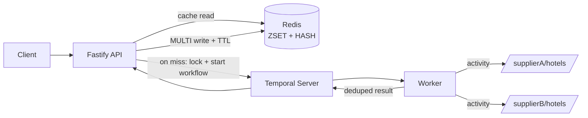

# Hotel Offer Orchestrator

Node.js + TypeScript service that gets hotel offers for a city from two suppliers, merges them, and caches the result in Redis. The supplier calls run as Temporal activities, so timeouts and retries are handled by Temporal and one slow or broken supplier doesn't take the API down.

Stack: Fastify, Temporal (TypeScript SDK), Redis (ioredis), Zod, pino, Jest.

## Running it

With Docker:

```bash
docker compose up --build
```

This starts Redis, Postgres, Temporal (auto-setup), Temporal UI on http://localhost:8080, the API on http://localhost:3000, and the worker. The api and worker may restart once or twice on the first run while Temporal is still starting.

Without Docker you need Redis on 6379 and a Temporal server on 7233 (`temporal server start-dev` works fine). Then:

```bash
npm install
cp .env.example .env    # defaults work for local
npm run build
npm run start:api       # terminal 1
npm run start:worker    # terminal 2
npm test
```

All settings are in `.env.example` and are validated with Zod at startup. The process exits if something is wrong.

## API

```bash
# all hotels for a city (first call is a cache miss, next ones are hits)
curl -i "http://localhost:3000/api/hotels?city=delhi"

# price filter (inclusive)
curl "http://localhost:3000/api/hotels?city=delhi&minPrice=4000&maxPrice=12000"

# health of redis, temporal and both suppliers
curl "http://localhost:3000/health"

# mock suppliers directly
curl "http://localhost:3000/supplierA/hotels?city=delhi"
curl "http://localhost:3000/supplierB/hotels?city=delhi&simulate=fail"
```

Sample response (trimmed):

```json
{
  "data": [
    { "id": "ginger-delhi-vivek-vihar", "name": "Ginger Delhi Vivek Vihar", "city": "delhi", "price": 2800, "commissionPct": 5, "supplier": "supplierB" },
    { "id": "taj-palace", "name": "TAJ PALACE", "city": "delhi", "price": 11800, "commissionPct": 13, "supplier": "supplierB" }
  ],
  "meta": {
    "city": "delhi",
    "degraded": false,
    "failedSuppliers": [],
    "suppliers": { "supplierA": { "status": "ok", "offers": 6 }, "supplierB": { "status": "ok", "offers": 6 } },
    "fetchedAt": "2026-11-13T05:00:00.000Z",
    "source": "cache",
    "count": 8,
    "filters": { "minPrice": null, "maxPrice": null }
  }
}
```

The response also has an `x-cache: HIT|MISS` header, and `x-degraded` when a supplier failed.

Bad input (for example `minPrice > maxPrice`) returns 400 with details. If both suppliers fail you get 502.

### Testing degraded mode

Set `SUPPLIER_B_MODE=fail` (or `timeout`) and restart, or switch it at runtime (disabled when `NODE_ENV=production`):

```bash
curl -X PUT localhost:3000/supplierB/mode -H 'content-type: application/json' -d '{"mode":"timeout"}'
curl "localhost:3000/api/hotels?city=mumbai"   # meta.degraded = true, failedSuppliers = ["supplierB"]
```

Delhi may already be cached, so use another city or wait for the TTL.

## How it works



Request flow for `GET /api/hotels`:

1. Validate the query with Zod.
2. Read from Redis. On a hit, return it. No supplier call.
3. On a miss, take a short Redis lock for the city and run `hotelOffersWorkflow`.
4. The workflow calls `fetchSupplierA` and `fetchSupplierB` in parallel (`Promise.allSettled`). Each activity has a 2s timeout and up to 3 attempts with backoff. 4xx responses are not retried.
5. If one supplier fails, the workflow continues with the other and marks the result as degraded. If both fail, the workflow fails and the API returns 502.
6. Dedupe the offers, write them to Redis in one MULTI, return the response.

Code layout:

```
src/
  config/env.ts                    env schema (Zod)
  routes/                          hotels, health, query schema
  services/                        hotel service, dedup, price range, health checks
  workflows/                       Temporal workflow + aggregate logic
  activities/                      supplier HTTP calls
  temporal/                        client connection, workflow starter
  cache/                           Redis repository and keys
  suppliers/                       mock supplier routes and data
  lib/                             logger, errors, error handler
  app.ts  server.ts  worker.ts
tests/
```

## Design notes

**Dedup.** Hotel names are normalized (lowercase, accents removed, `&` to `and`, punctuation and extra spaces removed), so "The Leela Palace" and "the leela  palace" are the same hotel. One pass over all offers with a `Map` keyed by the normalized name keeps the best offer: lower price wins, on equal price higher commission wins, and if both are equal the supplier name decides so the output doesn't change between runs. That's O(n) time and O(k) memory for n offers and k unique hotels, plus O(k log k) to sort the final list. The dedup code is pure, so it runs inside the workflow and is easy to test.

**Why ZSET + HASH.** Each city has three keys:

- `hotels:{city}:by_price` is a ZSET with hotel id as member and price as score.
- `hotels:{city}:details` is a HASH with hotel id mapped to hotel JSON.
- `hotels:{city}:meta` holds supplier status and fetch time. If it exists, it's a hit.

A price filter is just `ZRANGEBYSCORE min max`, which is O(log N + M) and already sorted by price. Then one `HMGET` gets only the matching hotels. The read is two round trips: GET meta and ZRANGEBYSCORE go in one pipeline, then HMGET. A single JSON blob per city would mean loading and filtering every hotel in Node on every request. One hash per city instead of one per hotel keeps it to 3 keys and a single HMGET.

The write is one `MULTI`: delete the old keys, variadic `ZADD` and `HSET`, set the TTLs. Readers never see half of an update. The data keys get a TTL a few seconds longer than meta, so if meta is present the data is always there. Cities with no hotels are cached too, so unknown cities don't hit the suppliers every time. The `{city}` part is a Redis Cluster hash tag, which keeps the MULTI valid if this ever moves to a cluster.

**Stampede protection.** When the cache expires and 100 requests for the same city arrive together, we want one supplier fetch, not 100. There are three layers:

1. In-process single flight. A `Map<city, Promise>` means concurrent misses in one API instance share one promise.
2. Redis lock across instances. `SET lock:hotels:{city} <token> NX PX 8000`. Only the holder runs the workflow. The others poll for the cache with a small backoff (50ms up to 400ms) and then read from it. The lock is released with a Lua compare-and-delete, so an instance never removes someone else's lock. If the wait times out (say the holder crashed), the request fetches anyway instead of erroring.
3. Temporal workflow id. The workflow id is `hotel-offers-<city>` with `workflowIdConflictPolicy: USE_EXISTING`, so even if two instances get past the lock they attach to the same run.

**Degraded mode.** A degraded result is cached for only 30s (normal TTL is 300s), so we go back to full results soon after the supplier recovers. `/health` returns 503 only when Redis or Temporal is down. A supplier being down shows as `degraded` with 200, because the API can still answer.

**Other choices.**

- Fastify with pino for low overhead and JSON logs.
- ioredis with `enableAutoPipelining`.
- The activity timeout is shorter than the workflow timeout, so one supplier can't use up the whole request.
- Supplier responses are validated with Zod before mapping, because a supplier sending bad data shouldn't break the cache.
- A failed cache write is logged and the request still succeeds.
- All errors go through one Fastify error handler and come back as `{ error: { code, message, details } }`.
- On SIGTERM the API stops accepting requests, finishes in-flight ones, then closes Redis and Temporal. The worker uses Temporal's built-in shutdown with a 10s grace time.

## Tests

`npm test` runs 53 Jest tests. None of them need Redis or Temporal running.

- `dedup.test.ts`: name normalization, cheapest wins, commission tie-break, full tie.
- `priceRange.test.ts`: ZRANGEBYSCORE bounds, inclusive filter, cache keys, query validation.
- `aggregate.test.ts`: parallel calls, degraded mode with one supplier failing, both failing. The activities are mocked.
- `hotelCache.repository.test.ts`: ZSET/HASH write and read, price filter, TTL, lock ownership (uses ioredis-mock).
- `hotel.service.test.ts`: cache hit and miss, single flight (50 concurrent requests, 1 workflow), lock wait, degraded TTL.
- `supplier.activities.test.ts`: payload mapping, retryable and non-retryable errors.
- `app.test.ts`: routes, validation errors, error mapping, /health.

## Possible next steps

- Serve stale data while refreshing in the background (stale-while-revalidate).
- Rate limiting and an API key.
- Metrics (Prometheus) for cache hit ratio and supplier latency.
